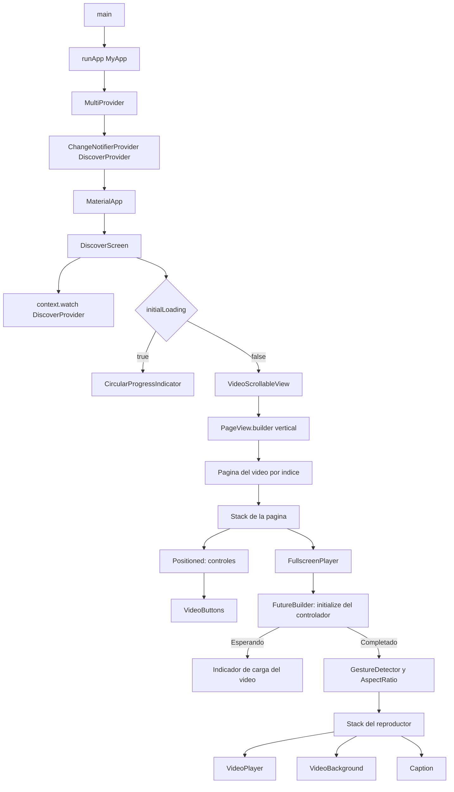
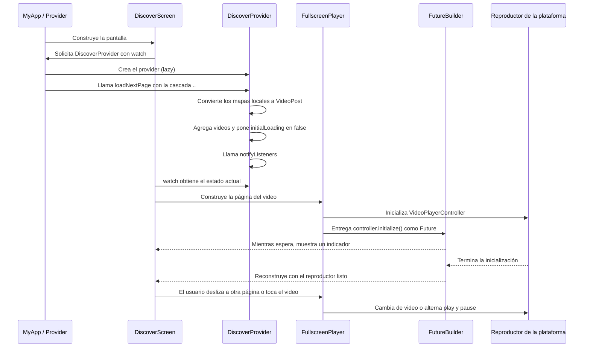

# TokTik App

Aplicación de Flutter para explorar videos cortos en un feed vertical. Este proyecto forma parte de un curso y sirve para practicar widgets, estado con `provider`, modelos de datos, recursos locales y operaciones asíncronas con `Future` y `FutureBuilder`.

> El proyecto está pensado para aprender y experimentar. Actualmente usa datos y videos de prueba incluidos en la app; no tiene backend, inicio de sesión ni base de datos.

## Qué hace la app

- Muestra videos en páginas verticales que se recorren deslizando.
- Reproduce cada video automáticamente, sin sonido y en bucle.
- Permite pausar o reanudar el video tocando la pantalla.
- Superpone el caption, las cifras de likes y views y algunos iconos.
- Presenta un indicador mientras el controlador del video se inicializa.

Los botones de likes y views son visuales por ahora: no guardan cambios. La animación del icono de reproducción tampoco controla el video.

## Cómo ejecutar el proyecto

Necesitas tener instalado Flutter y un emulador, simulador o dispositivo configurado.

Desde la carpeta `tok_tik_app`:

```bash
flutter pub get
flutter run
```

Para comprobar el análisis estático y ejecutar las pruebas disponibles:

```bash
flutter analyze
flutter test
```

Los videos están declarados como assets en `pubspec.yaml` y se encuentran en `assets/videos/`.

## Estructura principal

```text
lib/
├── main.dart
├── config/
│   ├── helpers/
│   └── theme/
├── domain/
│   └── entities/
│       └── video_post.dart
├── infrastructure/
│   └── models/
│       └── local_video_model.dart
├── presentation/
│   ├── providers/
│   │   └── discover_provider.dart
│   ├── screens/
│   │   └── discover/
│   │       └── discover_screen.dart
│   └── widgets/
│       └── shared/
└── shared/
    └── data/
        └── local_video_post.dart
```

### Responsabilidad de las piezas

- `main.dart` inicia Flutter, configura el tema y coloca `DiscoverProvider` por encima de la app con `ChangeNotifierProvider`.
- `DiscoverProvider` mantiene el estado de la pantalla de descubrimiento: la lista de videos y la bandera `initialLoading`.
- `DiscoverScreen` observa el provider con `context.watch`. Muestra carga o el feed según el estado.
- `VideoScrollableView` construye una página vertical por video con `PageView.builder`.
- `FullscreenPlayer` administra el `VideoPlayerController`, inicializa el reproductor, responde al toque y libera el controlador al destruirse.
- `VideoPost` es la entidad con los datos que necesita la app.
- `LocalVideoModel` convierte los mapas locales en un modelo tipado y luego en la entidad `VideoPost`.
- `videoPosts` contiene los datos locales de prueba.

## Árbol de widgets

Este diagrama muestra cómo se anidan los widgets principales. `MultiProvider` da acceso al provider a los widgets descendientes; dentro de `DiscoverScreen`, `context.watch` observa sus cambios.



`Stack` permite colocar capas una encima de otra: el reproductor ocupa el fondo y los controles, el gradiente y el caption se dibujan encima. `Positioned` ubica algunos de esos elementos respecto a los bordes del `Stack`.

## Flujo del provider y de los Futures

El provider se crea de forma diferida (*lazy*): `ChangeNotifierProvider` espera hasta que un descendiente lo solicite. En esta app ocurre cuando `DiscoverScreen` ejecuta `context.watch<DiscoverProvider>()`. Al crearlo, `..loadNextPage()` llama al método sobre esa misma instancia.



### Qué significa la espera en cada parte

**Carga de videos del provider.** `loadNextPage()` tiene tipo de retorno `Future<void>` porque está marcado como `async`, pero actualmente no contiene ningún `await` activo. Convierte los datos que ya están en memoria, actualiza el estado y notifica enseguida; no está descargando datos ni esperando una base de datos. Por eso el indicador controlado por `initialLoading` puede no llegar a verse. Hay un `Future.delayed` comentado que se puede activar para simular una espera durante el ejercicio.

Como esta carga local ocurre mientras se crea el provider, la pantalla puede leer directamente el estado ya actualizado en su primer build. Si más adelante se añade una operación realmente asíncrona —por ejemplo, una petición HTTP—, el provider puede conservar `initialLoading` en `true` mientras espera y llamar a `notifyListeners()` al terminar para que la pantalla muestre los datos.

**Inicialización del reproductor.** `controller.initialize()` sí representa una operación asíncrona: el reproductor necesita prepararse antes de que la app pueda usarlo. `FutureBuilder` recibe ese `Future`, muestra el indicador mientras `connectionState` no es `done` y después construye el video. El código actual asume que la inicialización termina correctamente; una versión más robusta también trataría `snapshot.hasError`.

Un `Future` representa un resultado que estará disponible más adelante. `await` pausa únicamente la continuación de esa función asíncrona; no congela la interfaz de Flutter. Mientras llega el resultado, el event loop puede procesar eventos y dibujar la UI.

### El operador de cascada `..`

En esta expresión:

```dart
create: (_) => DiscoverProvider()..loadNextPage(),
```

`DiscoverProvider()` crea una instancia y `..loadNextPage()` llama el método sobre esa instancia. La expresión de cascada sigue teniendo como resultado el objeto `DiscoverProvider`, que es lo que `create` entrega a `ChangeNotifierProvider`. El `Future` que devuelve `loadNextPage()` no se espera aquí.

De forma equivalente, pero sin cascada, podría escribirse así:

```dart
create: (_) {
  final provider = DiscoverProvider();
  provider.loadNextPage();
  return provider;
},
```

La versión sin cascada puede ser más fácil de leer al aprender; ambas expresan el mismo flujo.

## Datos locales y conversión

El flujo de los datos de prueba es:

```text
videoPosts (Map<String, dynamic>)
    → LocalVideoModel.fromJson(...)
    → LocalVideoModel.toVideoPostEntity()
    → List<VideoPost> en DiscoverProvider
    → widgets de presentación
```

El modelo conoce el formato de los mapas locales; la entidad `VideoPost` expresa los datos que el resto de la app necesita. Esta separación ayuda a que los widgets no tengan que leer directamente claves como `name` o `videoUrl` de un mapa dinámico. Para este ejercicio no se necesita todavía añadir un repository: los datos están en memoria y solo hay una fuente.

## Paquetes principales

- [`provider`](https://pub.dev/packages/provider): acceso al estado compartido y notificación de cambios mediante `ChangeNotifier`.
- [`video_player`](https://pub.dev/packages/video_player): reproducción de videos usando las plataformas compatibles.
- [`animate_do`](https://pub.dev/packages/animate_do): animaciones de presentación para widgets.
- [`intl`](https://pub.dev/packages/intl): utilidades de formato; se usa para presentar cifras compactas.

## Estado actual y posibles siguientes pasos

- `loadNextPage()` transforma toda la lista local; el gesto de deslizar no solicita páginas adicionales.
- La lista `videoPosts` es mutable y global, adecuada para datos de prueba; podría encapsularse si la app necesitara modificarla o admitir más fuentes.
- El `FutureBuilder` recibe `controller.initialize()` desde `build`. Para una implementación más robusta convendría guardar el `Future` en el `State` e incluir una presentación explícita del estado de error.
- Los botones de interacción son solo visuales y no actualizan datos.
- Si se conectara una API o una base de datos, entonces tendría sentido evaluar una capa que encapsule esa fuente y pruebas para ella; no hace falta añadirla antes de tener ese problema.

## Recursos para aprender

- [Documentación de Flutter](https://docs.flutter.dev/)
- [Aprende Flutter](https://docs.flutter.dev/get-started/learn-flutter)
- [Documentación de Dart sobre programación asíncrona](https://dart.dev/language/async)
- [Paquete provider](https://pub.dev/packages/provider)
- [Paquete video_player](https://pub.dev/packages/video_player)
